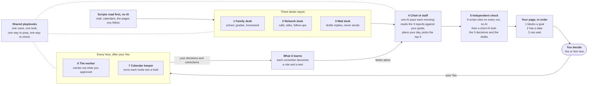

# AI chief of staff tool kit

Working templates for a personal AI chief of staff: seven agents with one job each, scripts that set the order,
and one page a day where you decide. Nothing is sent without your Yes.

This is the skeleton, with every personal detail taken out. It runs as it is on sample files (no AI, no accounts),
so you can see the whole flow first and then put your own readers and your own agent behind it.

## The picture



Four ideas hold it together:

1. **Scripts set the order.** A script starts each agent in its turn. No agent calls another, so you can always say which step produced what.
2. **Script first, AI for judgment.** Reading mail, comparing dates, writing the list and testing the page are plain code. AI is kept for reading, planning and drafting.
3. **One list, one writer.** Every open item lives in one file. Agents propose changes; one script writes them.
4. **Every correction becomes a rule and a test.** You say it once. It lands in the rules file, each agent gets its slice, and where code can check it, code does.

## Start in an afternoon

You need Python 3.9 or newer. Nothing to install.

1. **See it run (5 minutes).**
   ```
   python3 scripts/run_morning.py --demo
   python3 -m unittest discover tests
   ```
   The demo runs the whole morning on the files in `examples/` and writes `out-demo/2026-01-12/page.html`. Open it.
   Read what each script rule caught in the sample proposal: an answered item asked again, a wrong weekday, a second row
   for the same matter, a call time that was not free.
2. **Write your goals (20 minutes).** Edit `examples/goals.md` into your own: five goals at most, one measure each.
3. **Start your list (20 minutes).** `python3 scripts/ledger.py add "..." --owner you --needs "the one step" --due 2026-01-16`. Then `python3 scripts/ledger.py brief`.
4. **Write your rules (30 minutes).** Edit `rules/RULES.md`. Keep the Safety section. Run `python3 rules/slice_rules.py` to see each agent's slice.
5. **Make one desk (45 minutes).** Copy `agents/desk.md` to `agents/mail.md` and fill the three blanks. Start with one desk, not three.
6. **Plug in your reader and your agent (45 minutes).** Have your own script write `out/DAY/reads.json` (mail, calendar, whatever you follow).
   Set `AGENT_CMD` to any agent command that reads a prompt on standard input and prints JSON, then run `python3 scripts/run_morning.py`.
7. **Schedule it.** One run each morning. Later, a second one each hour that only does two things: carry out what you approved, and turn invites into holds.

Give it a week of mornings before you add the second and third desk. Each time it gets something wrong, do not fix the output:
add the rule, and if code can check it, add the check and its test.

## What is in the box

| File | What it is |
|------|------------|
| `scripts/run_morning.py` | The order of the run: read, slice the rules, desks, chief, script rules, page, self-check. Has a `--demo`. |
| `scripts/ledger.py` | The one list: add, brief, done, sleep, check, verify, and your answers written by script. |
| `scripts/script_rules.py` | The script-rules pattern: 9 rules in plain code that run before anything reaches you. |
| `scripts/build_page.py` | The page pattern: three decisions at most, then three tiers (blocks a goal, has a date, can wait). |
| `scripts/selfcheck.py` | The self-check pattern: the run looks for its own faults. Each one ends as a fix, a row or one plain line. |
| `rules/RULES.md` | The rules-file skeleton: one file, each line tagged with the agents it applies to. |
| `rules/slice_rules.py` | Hands each agent only its slice. An untagged rule goes to every agent until someone sorts it. |
| `agents/desk.md` | One desk prompt template: what it is given, what it does, the JSON it returns, its limits. |
| `agents/chief.md` | The chief prompt template: tiers, the top 3, a plan sized to the day, proposed changes to the list. |
| `playbooks/` | How a shared skill is written, a template, and three starters: one voice, one look, one way to prep a call. |
| `examples/` | Sample goals, reads, desk reports, a chief proposal with planted mistakes, a starting list. |
| `tests/` | 39 tests. Every script rule has at least one. |

## The seven agents and where each starts

| # | Agent | Its one job | Start from |
|---|-------|-------------|------------|
| 1 to 3 | The desks | Report what is new in one area. A drafting desk writes drafts and never sends. | `agents/desk.md` |
| 4 | Chief of staff | One pass each morning: tiers, top 3, the plan, proposed changes to the list. | `agents/chief.md` |
| 5 | Independent check | A short AI look at the 3 decisions and the drafts, after the script rules ran. | `agents/chief.md` as a model; its rules are tagged `check` |
| 6 | The worker | Each hour, carries out rows marked approved, and only the step the row names. | rules tagged `worker` |
| 7 | Calendar keeper | Each hour, turns each invite into a private hold. | rules tagged `calendar` |

Prompts for agents 5 to 7 are short enough to write from the rules tagged for them; the kit ships the two templates that take the most thought.

## Habits that keep it honest

- **The page test.** After the page is built, a script counts: every item that needs you must be on it.
- **Not now is an answer.** The row sleeps until its day and comes back by itself. It is not asked every morning.
- **Ask three times, then rest.** An ask with no answer after 3 mornings rests until Friday.
- **Friday is different.** The daily page shows the top 3. Friday shows everything, and at most 3 new ideas.
- **Re-check the list.** `python3 scripts/ledger.py verify` names the rows nobody has re-read against the live source.

## What is not here

Your readers (mail, calendar, any site you follow) and your agent command. Both are one step each in `run_morning.py`,
and both depend on the tools and accounts you use.

## License

MIT. See `LICENSE`.
